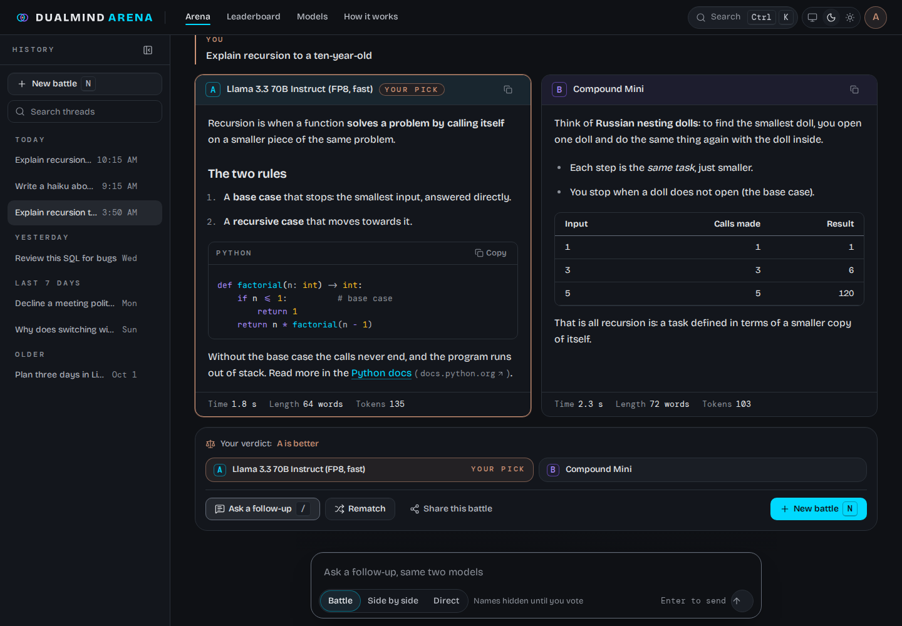
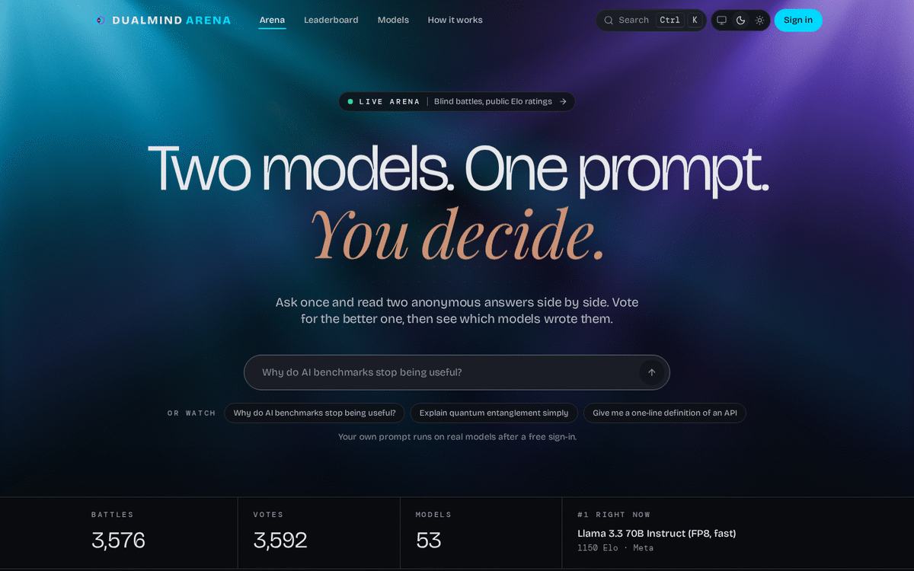
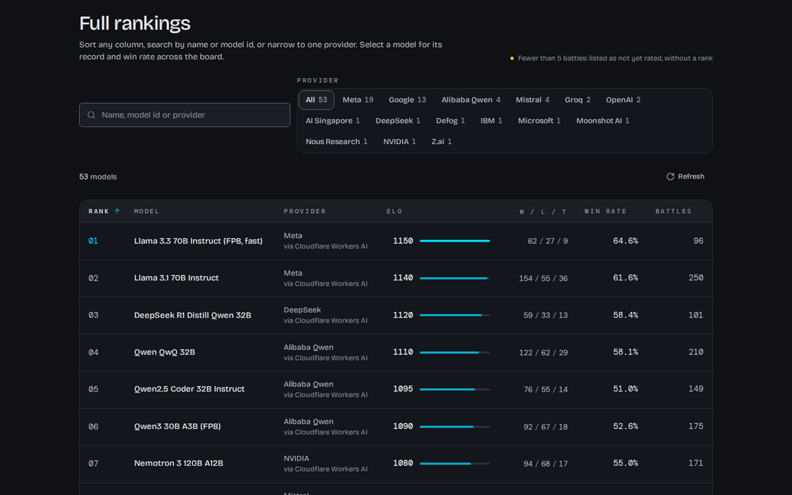
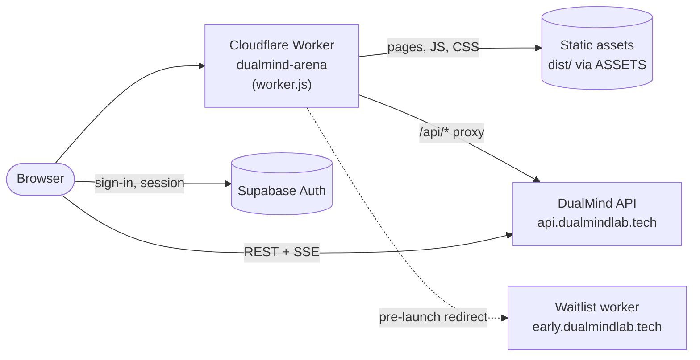

# DualMind Arena — Web App

**Blind, side-by-side AI model battles in the browser: ask once, compare two anonymous answers, vote, and watch the Elo leaderboard move.**

[](https://github.com/dualmindlabs/DualMind_UI/actions/workflows/ci.yml)
[](./LICENSE)
[](https://arena.dualmindlab.tech)
[](https://docs.dualmindlab.tech)

---

## Contents

- [What is this?](#what-is-this)
- [Screenshots](#screenshots)
- [Features](#features)
- [Tech stack](#tech-stack)
- [Architecture](#architecture)
- [Project structure](#project-structure)
- [Getting started](#getting-started)
- [Configuration](#configuration)
- [Deployment](#deployment)
- [API endpoints used](#api-endpoints-used)
- [Related repositories and sites](#related-repositories-and-sites)
- [Contributing, security and license](#contributing-security-and-license)

## What is this?

This repository is the front-end of **DualMind Arena**, the model comparison app built by DualMind Labs. You type a prompt, two models answer it side by side without their names, and you vote for the better answer. Votes feed an Elo rating system that powers a public leaderboard.

The app is a React 19 single-page app built with React Router in framework mode: every public page is prerendered to static HTML at build time and hydrates in the browser, so there is no server-side rendering at runtime. A Cloudflare Worker (`dualmind-arena`) serves the build at [arena.dualmindlab.tech](https://arena.dualmindlab.tech), proxies the API and sets the security headers. Users sign in with Supabase Auth, and all chat, vote, thread and leaderboard data comes from the DualMind API ([DualMind_Back](https://github.com/dualmindlabs/DualMind_Back)) at `api.dualmindlab.tech`.

## Screenshots

A blind battle after the vote: both answers, the revealed names, the verdict and what to do next.



| Landing page | Leaderboard |
| --- | --- |
|  |  |

The images come from the Playwright run in CI (`web.yml`, artifact `web-screenshots`), with recorded leaderboard data and mocked answers, in the dark theme on a 1440 px wide window.

## Features

- **Battle mode**: two anonymous models answer the same prompt; you vote before their identities are revealed.
- **Side by side**: pick the two models yourself, or leave a side on random, and compare them by name.
- **Direct mode**: one-on-one chat with a single model.
- **Streaming responses** over Server-Sent Events, with Markdown rendering (Streamdown) and syntax-highlighted code blocks.
- **Elo leaderboard** (`/leaderboard/`) and model directory (`/models/`), built from the public model-stats API, plus a page that explains the method (`/methodology/`).
- **Conversation threads**: saved history in the sidebar, with rename and delete.
- **Sharing**: make a thread public or link-only and open it at `/share/<id>`, with link-preview tags written by the Worker.
- **Export** from the settings page: download every conversation as Markdown, JSON, CSV, HTML or PDF (a print view), built in the browser.
- **Read aloud**: text-to-speech for responses through the API.
- **Accounts**: Supabase email and password, one-time codes, Google sign-in, password reset and email verification.
- **Light and dark themes**, a command palette (Ctrl+K), keyboard shortcuts, reduced-motion support, and a mock mode that answers every API call from memory (`VITE_API_MOCK=1`).
- **Info and legal pages**: about, how it works, FAQ, privacy, terms and cookies, and an API reference at `/developers/`. No analytics or tracking scripts.
- **Pre-launch waitlist**: a separate worker (`waitlist-worker/`) serves the waitlist page at `early.dualmindlab.tech`.

## Tech stack

| Layer | Technology |
| --- | --- |
| UI (`web/`) | React 19, React Router 8 (framework mode, pages prerendered at build time), Vite 8, TypeScript (strict), Tailwind CSS 4 with the design tokens in `web/src/styles/tokens.css`, shadcn-style primitives on Base UI, Motion, TanStack Query, Recharts ([docs/architecture.md](./docs/architecture.md)) |
| Auth | Supabase Auth (`@supabase/supabase-js` v2), session in the browser |
| Hosting | Cloudflare Workers with static assets (`wrangler.jsonc`, `worker.js`) |
| Feature flags | Cloudflare Flagship binding (`FLAGS`) |
| Backend | DualMind API (ASP.NET Core), see [DualMind_Back](https://github.com/dualmindlabs/DualMind_Back) |
| Tooling | Node.js 22 (`.node-version`), npm in `web/` (pnpm 10 at the root), ESLint, Prettier, Vitest, Playwright with axe, Lighthouse CI, Wrangler |
| CI | GitHub Actions: root lint and the composed build ([`ci.yml`](./.github/workflows/ci.yml)); the web app's checks, end-to-end tests, Lighthouse and screenshots ([`web.yml`](./.github/workflows/web.yml)); the Worker and API tests ([`api.yml`](./.github/workflows/api.yml)) |

## Architecture



- **Pages**: `/` is the prerendered landing page; a signed-in visitor gets the arena at the same URL (a small inline script in the head decides before the first paint, and the arena's code is a lazy chunk the landing page never loads). Pages that need a session (`/settings/`, `/share/<id>`, the auth callbacks) are client-only and get the SPA fallback page.
- **API calls** go through the typed client in `web/src/lib/api/`, same-origin to `/api/*`. It adds the Supabase bearer token and a request id, retries with backoff, supports cancellation, parses SSE streams and turns every failure into a typed error the UI shows as a state (empty, loading, offline, error).
- **The Worker** serves the files in `dist/`, proxies `/api/*` to the API, serves the Worker's own `/api/v2` routes, rate limits, sets the security headers and an enforced Content-Security-Policy (inline-script hashes come from the build), serves a real 404 page, and generates `robots.txt` and `sitemap.xml`. While the arena is in pre-launch, `FORCE_WAITLIST` in `worker.js` sends **every** request (all paths, `/api/*` included) to the waitlist at `early.dualmindlab.tech` with a temporary 302; `?preview=dualmind-preview` sets a 30-day cookie that bypasses it and `?preview=off` clears it. Set the constant to `false` to open the arena again.

## Project structure

```text
DualMind_UI/
├── web/                    # The React app (React Router, Vite, Tailwind); see web/README.md
│   ├── src/                # app/ (routes), features/, components/, lib/, styles/
│   └── tests/              # unit (Vitest), worker (Vitest) and e2e (Playwright + axe)
├── worker.js               # Cloudflare Worker: waitlist gate, API proxy, routing, static assets
├── server/                 # Worker modules: API proxy, v2 API, rate limits, caching, redirects, security headers and CSP
├── contract/               # Shared zod schemas for the public API
├── wrangler.jsonc          # Worker config (dualmind-arena)
├── build.js                # Composes dist/ from the web build, a few static files and the generated sitemap
├── config.js                    # Still shipped until the config cleanup (KNOWN_ISSUES.md)
├── assets/                 # Static images
├── tests/api/              # Worker and API tests (Vitest)
├── legacy/                 # Retired pages, tests and tools, kept for reference only
├── waitlist-worker/        # Pre-launch waitlist: Vite + React app and its worker
├── docs/                   # Architecture, ADRs, API reference, the redesign plan and audits
└── AGENTS.md, CLAUDE.md    # Contributor and agent guides
```

## Getting started

### Prerequisites

- [Node.js](https://nodejs.org/) 22.22 or newer (`.node-version`; CI uses it)
- For the full app locally: the [DualMind API](https://github.com/dualmindlabs/DualMind_Back) on `http://localhost:5079`, or no API at all with `VITE_API_MOCK=1`
- For deploys: a Cloudflare account with access to the `dualmind-arena` worker

### Install and run

```bash
git clone https://github.com/dualmindlabs/DualMind_UI.git
cd DualMind_UI/web
npm ci
npm run dev     # http://localhost:5173
```

Local overrides go in `web/.env.local` (see `web/.env.example`). Without `VITE_SUPABASE_URL` and `VITE_SUPABASE_ANON_KEY` the sign-in pages show a "sign-in unavailable" notice.

### Check and test

```bash
npm run check       # typecheck, lint, format check and unit tests
npm run test:e2e    # Playwright against the composed build; run `node build.js` at the repo root first
```

On a small machine, push the branch and let GitHub Actions run the heavy parts ([`web.yml`](./.github/workflows/web.yml)): the e2e shards, axe in both themes, Lighthouse and the screenshots.

### Build

```bash
node build.js   # at the repo root: builds web/ and composes dist/
```

`build.js` installs and builds the React app in `web/` itself (set `SKIP_WEB_BUILD=1` if it is built already), so the same command works locally, in CI and in Cloudflare Workers Builds. Working on the React app: see [`web/README.md`](./web/README.md).

## Configuration

The web app reads public build-time values from `VITE_` variables (`web/.env.example`, validated in `web/src/config/`). Never put a secret or a service-role key in them.

| Variable | Description |
| --- | --- |
| `VITE_SITE_URL` | Public origin for canonical and Open Graph URLs (default `https://arena.dualmindlab.tech`). |
| `VITE_API_BASE_URL` | API origin; empty means same-origin `/api/*`, which the Worker proxies. |
| `VITE_API_MOCK` | `1` answers every API call from an in-memory mock (demo and offline mode, e2e tests). |
| `VITE_SUPABASE_URL`, `VITE_SUPABASE_ANON_KEY` | Public Supabase project values for sign-in. Production and previews read them from the Workers Builds build variables. |
| `VITE_FEATURE_PHONE_SIGNIN`, `VITE_FEATURE_GUEST_BATTLE`, `VITE_FEATURE_PRIVATE_ARENA` | Launch features, all off unless set to `1`. The guest battle and the private arena also need the backend's flag (`GET /api/config/public`). |
| `VITE_ANALYTICS_TOKEN` | Cloudflare Web Analytics site token. Unset means no analytics; set, the beacon loads only after the visitor accepts. |

Cloudflare Worker settings:

| Name | Where | Description |
| --- | --- | --- |
| `BACKEND_URL` | `dualmind-arena` worker variable (optional) | Origin that `/api/*` requests are proxied to. Defaults to the production API. |
| `ASSETS` | Binding in `wrangler.jsonc` | Static assets served from `dist/`. |
| `FLAGS` | Binding in `wrangler.jsonc` | Cloudflare Flagship feature-flag app. |
| `WISHLIST_ACTIVE` | `dualmind-waitlist` worker variable (optional) | Fallback for the `wishlist-active` flag when no `FLAGS` binding is present. |

## Deployment

The arena runs as the Cloudflare Worker **`dualmind-arena`** on the route `arena.dualmindlab.tech/*`.

- **Cloudflare Workers Builds** is connected to this repository and builds the worker from GitHub (it reports as the `Workers Builds: dualmind-arena` check). It deploys `master` and publishes a preview alias URL for every other branch (`https://<branch-slug>-dualmind-arena.creharsh.workers.dev`; add `?preview=dualmind-preview` once to pass the waitlist gate). See [ADR 0005](./docs/adr/0005-workers-builds-deploys-and-previews.md).
- **Manual deploy** from a machine logged in to Cloudflare:

  ```bash
  pnpm run deploy   # pnpm build, then npx wrangler deploy (wrangler.jsonc)
  ```

- **Waitlist worker** (`dualmind-waitlist`, served at `early.dualmindlab.tech`): a Vite + React app in `waitlist-worker/` whose worker also stores signups in the D1 database `dualmind-waitlist`. GitHub Actions ([`deploy-waitlist.yml`](./.github/workflows/deploy-waitlist.yml)) deploys it on every push to `master` that touches `waitlist-worker/`, or by hand with `gh workflow run deploy-waitlist.yml`; it needs the `CLOUDFLARE_API_TOKEN` repository secret. See [`waitlist-worker/README.md`](./waitlist-worker/README.md).

GitHub Actions ([`ci.yml`](./.github/workflows/ci.yml)) runs lint and build on every push and pull request to `master` and uploads `dist/` as an artifact; [`web.yml`](./.github/workflows/web.yml) checks and tests the web app; [`api.yml`](./.github/workflows/api.yml) tests the Worker's API. Neither deploys the Arena.

## API endpoints used

All requests go to the DualMind API with the user's Supabase access token as a bearer token.

| Method | Endpoint | Purpose |
| --- | --- | --- |
| `POST` | `/api/arena/chat` | Single-model chat |
| `POST` | `/api/arena/chat/stream` | Single-model chat, streamed (SSE) |
| `POST` | `/api/arena/dualchat` | Two-model anonymous battle |
| `POST` | `/api/arena/model-vote` | Submit a vote |
| `GET` | `/api/arena/model-stats` | Leaderboard and Elo stats |
| `GET` | `/api/models`, `/api/models/{id}` | Model catalogue |
| `GET` `POST` `PATCH` `DELETE` | `/api/threads`, `/api/threads/{id}`, `/api/threads/{id}/messages` | Conversation threads |
| `POST` | `/api/speech/generate` | Text-to-speech (the Worker also answers the old `/api/audio/tts` path) |
| `POST` `GET` | `/api/users/sync`, `/api/users/me` | User profile sync |
| `GET` | `/health` (via `/api/health`) | API health check |

Full API reference: [docs.dualmindlab.tech](https://docs.dualmindlab.tech). Contract details for every call (types, errors, streaming, known issues): [`docs/api/endpoints.md`](./docs/api/endpoints.md).

## Related repositories and sites

| Project | Description | Link |
| --- | --- | --- |
| **DualMind_UI** (this repo) | Arena web app | [arena.dualmindlab.tech](https://arena.dualmindlab.tech) |
| [DualMind_Back](https://github.com/dualmindlabs/DualMind_Back) (private) | ASP.NET Core API: chat, battles, votes, Elo, threads, admin | [api.dualmindlab.tech](https://api.dualmindlab.tech/health) |
| [DualMind_Admin-UI](https://github.com/dualmindlabs/DualMind_Admin-UI) (private) | Admin panel for users, models, providers and votes | [admin.dualmindlab.tech](https://admin.dualmindlab.tech) |
| [dualmind-claw-gateway](https://github.com/dualmindlabs/dualmind-claw-gateway) (private) | OpenClaw gateway on Cloudflare Workers and Containers | Not public |
| Documentation | Public user and API docs | [docs.dualmindlab.tech](https://docs.dualmindlab.tech) |
| Developer docs | Architecture, deployment and development guides | [dev-doc.dualmindlab.tech](https://dev-doc.dualmindlab.tech) |
| Website | DualMind Labs landing page | [dualmindlab.tech](https://dualmindlab.tech) |

## Contributing, security and license

- **Contributing**: read [CONTRIBUTING.md](./CONTRIBUTING.md) and the architecture notes in [AGENTS.md](./AGENTS.md). Work happens on `feat/`, `fix/` or `chore/` branches and lands through pull requests.
- **Code of conduct**: [CODE_OF_CONDUCT.md](./CODE_OF_CONDUCT.md) (Contributor Covenant 2.1).
- **Security**: please do not open public issues for vulnerabilities. Report them privately as described in [SECURITY.md](./SECURITY.md).
- **Support**: see [SUPPORT.md](./SUPPORT.md).
- **Changelog**: [CHANGELOG.md](./CHANGELOG.md).
- **Further reading**: [docs/CODEBASE_AUDIT.md](./docs/CODEBASE_AUDIT.md), [docs/DEEP_AUDIT.md](./docs/DEEP_AUDIT.md) and [docs/UI_ROADMAP.md](./docs/UI_ROADMAP.md).
- **Redesign plan**: the move to React + Vite + Tailwind (done at the cutover) is described in [docs/redesign/](./docs/redesign/): [design direction](./docs/redesign/design-direction.md), [screen inventory](./docs/redesign/screen-inventory.md), [migration plan](./docs/redesign/migration-plan.md) and [new features](./docs/redesign/new-features.md).
- **License**: proprietary. Copyright (c) 2026 DualMind Labs. All rights reserved. See [LICENSE](./LICENSE).
