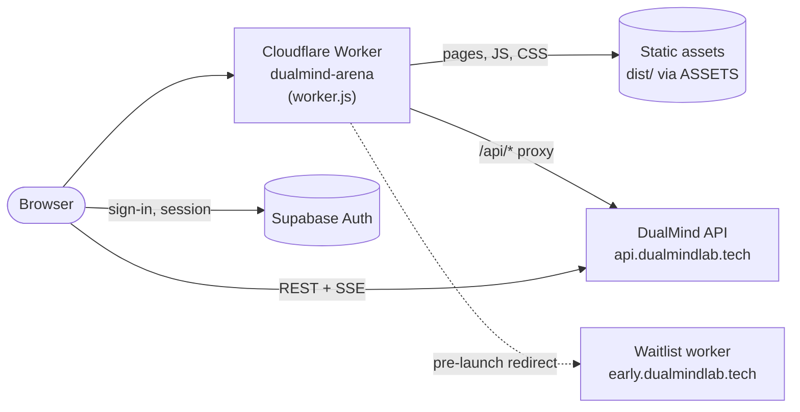

# DualMind Arena — Web App

**Blind, side-by-side AI model battles in the browser: ask once, compare two anonymous answers, vote, and watch the Elo leaderboard move.**

[](https://github.com/dualmindlabs/DualMind_UI/actions/workflows/ci.yml)
[](./LICENSE)
[](https://arena.dualmindlab.tech)
[](https://docs.dualmindlab.tech)

---

## Contents

- [What is this?](#what-is-this)
- [Features](#features)
- [Tech stack](#tech-stack)
- [Architecture](#architecture)
- [Project structure](#project-structure)
- [Getting started](#getting-started)
- [Configuration](#configuration)
- [Deployment](#deployment)
- [API endpoints used](#api-endpoints-used)
- [Related repositories and sites](#related-repositories-and-sites)
- [Contributing, security and license](#contributing-security-and-license)

## What is this?

This repository is the front-end of **DualMind Arena**, the model comparison app built by DualMind Labs. You type a prompt, two models answer it side by side without their names, and you vote for the better answer. Votes feed an Elo rating system that powers a public leaderboard.

The app is a static, framework-free web app (HTML, CSS and ES modules). A Cloudflare Worker (`dualmind-arena`) serves it at [arena.dualmindlab.tech](https://arena.dualmindlab.tech). Users sign in with Supabase Auth, and all chat, vote, thread and leaderboard data comes from the DualMind API ([DualMind_Back](https://github.com/dualmindlabs/DualMind_Back)) at `api.dualmindlab.tech`.

## Features

- **Battle mode**: two anonymous models answer the same prompt; you vote before their identities are revealed.
- **Arena mode**: pick the model pair yourself and compare them with names visible.
- **Direct mode**: one-on-one chat with a single model.
- **Streaming responses** over Server-Sent Events, with Markdown rendering, syntax highlighting and DOMPurify sanitising.
- **Elo leaderboard**: model rankings and stats, as a modal and as a standalone `/leaderboard/` page.
- **Conversation threads**: saved history in the sidebar, with rename and delete.
- **Sharing**: make a thread public or link-only and open it in a read-only `/share/` view.
- **Export**: download a conversation as Markdown, JSON, CSV, HTML or PDF.
- **Read aloud**: text-to-speech for responses through the API.
- **Chat input tools**: file attachments, plus code-mode and web-search toggles (today these tune the sampling temperature sent with the request).
- **Accounts**: Supabase email and password, one-time codes, Google sign-in, password reset and email verification.
- **Light and dark themes**, responsive layout, and an offline mock mode when the API is unreachable.
- **Info pages**: about, how it works, models, FAQ, privacy, terms and cookies.
- **Pre-launch waitlist**: a separate worker (`waitlist-worker/`) serves the waitlist page at `early.dualmindlab.tech`.

## Tech stack

| Layer | Technology |
| --- | --- |
| UI (legacy) | Vanilla JavaScript (ES modules), HTML, custom CSS design tokens (`css/tokens.css`), no framework and no bundler |
| UI (new, `web/`) | React 19, React Router 8 (framework mode, pages prerendered at build time), Vite 8, TypeScript (strict), Tailwind CSS 4 with the tokens in `web/src/styles/tokens.css`; replacing the legacy pages slice by slice ([docs/architecture.md](./docs/architecture.md)) |
| Rendering helpers | `marked`, `DOMPurify` and `highlight.js`, loaded from CDNs |
| Auth | Supabase Auth (`@supabase/supabase-js` v2 from a CDN), session in the browser |
| Hosting | Cloudflare Workers with static assets (`wrangler.jsonc`, `worker.js`) |
| Feature flags | Cloudflare Flagship binding (`FLAGS`) |
| Backend | DualMind API (ASP.NET Core), see [DualMind_Back](https://github.com/dualmindlabs/DualMind_Back) |
| Tooling | Node.js 22 (`.node-version`), pnpm 10 at the root and npm in `web/`, ESLint, Prettier, Vitest, Playwright, Wrangler |
| CI | GitHub Actions: root lint and the composed build ([`ci.yml`](./.github/workflows/ci.yml)); the web app's checks, end-to-end tests and screenshots ([`web.yml`](./.github/workflows/web.yml)) |

## Architecture



- **Boot order**: `config.js` loads first and sets `window.DUALMIND_CONFIG`. `js/auth/supabase-init.js` restores the Supabase session and exposes `window.DualMindAuth` and `window.DualMindAuthReady`. `js/ui/app.js` waits for auth, syncs the user with the API, then renders the app.
- **API calls** go through the single client in `js/apiInstance.js` (`DualMindApi`), which adds the Supabase bearer token, retries with backoff, supports cancellation and parses SSE streams.
- **Components** in `components/` talk to the app through `document` CustomEvents (`mode-change`, `chat-submit`, `vote-submit` and so on). The full event and globals reference is in [AGENTS.md](./AGENTS.md).
- **The worker** serves the files in `dist/`, proxies `/api/*` to the API (and `/api/health` to `/health`), rewrites `/share/*` to the share page, and generates `robots.txt` and `sitemap.xml`. While the arena is in pre-launch, `FORCE_WAITLIST` in `worker.js` sends **every** request (all paths, `/api/*` included) to the waitlist at `early.dualmindlab.tech` with a temporary 302; `?preview=dualmind-preview` sets a 30-day cookie that bypasses it and `?preview=off` clears it. Set the constant to `false` to open the arena again.

## Project structure

```text
DualMind_UI/
├── index.html              # Main app shell
├── config.js               # Runtime config (window.DUALMIND_CONFIG), loaded first
├── web/                    # The new React app (React Router, Vite, Tailwind); see web/README.md
├── worker.js               # Cloudflare Worker: waitlist gate, API proxy, routing, static assets
├── server/routing.js       # Worker helpers: asset caching, SPA fallback routes, noindex
├── wrangler.jsonc          # Worker config (dualmind-arena)
├── build.js                # Composes dist/: legacy files + the web app's build
├── components/             # Header, Sidebar, ChatInput, ChatView, modals, share view
├── js/
│   ├── ui/app.js           # Main App class: state, modes, streaming, voting, threads
│   ├── apiInstance.js      # API client singleton
│   ├── api/                # DualMindApi facade, HttpClient, services, error helpers
│   ├── auth/               # Supabase auth service and init
│   ├── chatExport.js       # MD / JSON / CSV / HTML / PDF export
│   └── leaderboardPage.js  # Standalone leaderboard page
├── css/                    # Design tokens and component styles
├── login/, *.html          # Sign-in, sign-up, verification and password pages
├── leaderboard/, share/    # Standalone leaderboard and shared-thread pages
├── about/, faq/, models/…  # Static info and legal pages
├── waitlist-worker/        # Pre-launch waitlist: Vite + React app and its worker
├── tests/                  # Playwright end-to-end tests
├── docs/                   # Architecture, ADRs, the redesign plan and codebase audits
└── AGENTS.md               # Detailed architecture and contributor guide
```

## Getting started

### Prerequisites

- [Node.js](https://nodejs.org/) 20 (the version CI uses)
- [pnpm](https://pnpm.io/) 10 (CI installs with the committed `pnpm-lock.yaml`)
- For the full app locally: the [DualMind API](https://github.com/dualmindlabs/DualMind_Back) running on `http://localhost:5079`
- For deploys: a Cloudflare account with access to the `dualmind-arena` worker

### Install

```bash
git clone https://github.com/dualmindlabs/DualMind_UI.git
cd DualMind_UI
pnpm install
```

### Run

```bash
pnpm dev        # static server on http://localhost:8000
```

When the app is served from `localhost`, `config.js` points the API client at the local API instead of production. If the API is unreachable, the arena falls back to its offline mock mode.

### Lint

```bash
pnpm lint       # ESLint (eslint.config.mjs)
pnpm lint:fix   # ESLint with --fix
```

### Test

```bash
pnpm exec playwright install chromium   # once, downloads the browser
pnpm test                               # Playwright; starts its own server on port 8000
```

### Build

```bash
pnpm build      # node build.js: builds web/, copies the legacy files and composes dist/
```

`build.js` installs and builds the React app in `web/` itself (set `SKIP_WEB_BUILD=1` if it is built already), so the same command works locally, in CI and in Cloudflare Workers Builds. Working on the React app: see [`web/README.md`](./web/README.md).

## Configuration

There is no `.env` file. The browser app reads its settings from `window.DUALMIND_CONFIG`, set in `config.js` (see `config.example.js` for the template). Values set on that object before `config.js` loads take precedence.

| Setting | Description |
| --- | --- |
| `apiBaseUrl` / `backendUrl` | Base URL of the DualMind API. Switches to the local API automatically on `localhost`. |
| `supabase.url` | Supabase project URL used for sign-in. |
| `supabase.anonKey` | Supabase anon (public) key. Never put a service-role key here. |
| `supabase.authEmailFunctionUrl` | Supabase Edge Function that sends auth emails. |
| `supabase.storageBucket` | Supabase Storage bucket for user avatars. |
| `auth.mode` | `supabase` (sign in directly with Supabase) or `backend`. |
| `features.streaming`, `features.voting`, `features.threads`, `features.leaderboard` | Feature toggles; all on by default. |

Cloudflare Worker settings:

| Name | Where | Description |
| --- | --- | --- |
| `BACKEND_URL` | `dualmind-arena` worker variable (optional) | Origin that `/api/*` requests are proxied to. Defaults to the production API. |
| `ASSETS` | Binding in `wrangler.jsonc` | Static assets served from `dist/`. |
| `FLAGS` | Binding in `wrangler.jsonc` | Cloudflare Flagship feature-flag app. |
| `WISHLIST_ACTIVE` | `dualmind-waitlist` worker variable (optional) | Fallback for the `wishlist-active` flag when no `FLAGS` binding is present. |

## Deployment

The arena runs as the Cloudflare Worker **`dualmind-arena`** on the route `arena.dualmindlab.tech/*`.

- **Cloudflare Workers Builds** is connected to this repository and builds the worker from GitHub (it reports as the `Workers Builds: dualmind-arena` check). It deploys `master` and publishes a preview alias URL for every other branch (`https://<branch-slug>-dualmind-arena.creharsh.workers.dev`; add `?preview=dualmind-preview` once to pass the waitlist gate). See [ADR 0005](./docs/adr/0005-workers-builds-deploys-and-previews.md).
- **Manual deploy** from a machine logged in to Cloudflare:

  ```bash
  pnpm run deploy   # pnpm build, then npx wrangler deploy (wrangler.jsonc)
  ```

- **Waitlist worker** (`dualmind-waitlist`, served at `early.dualmindlab.tech`): a Vite + React app in `waitlist-worker/` whose worker also stores signups in the D1 database `dualmind-waitlist`. GitHub Actions ([`deploy-waitlist.yml`](./.github/workflows/deploy-waitlist.yml)) deploys it on every push to `master` that touches `waitlist-worker/`, or by hand with `gh workflow run deploy-waitlist.yml`; it needs the `CLOUDFLARE_API_TOKEN` repository secret. See [`waitlist-worker/README.md`](./waitlist-worker/README.md).

GitHub Actions ([`ci.yml`](./.github/workflows/ci.yml)) runs lint and build on every push and pull request to `master` and uploads `dist/` as an artifact; [`web.yml`](./.github/workflows/web.yml) checks and tests the web app. Neither deploys the Arena.

## API endpoints used

All requests go to the DualMind API with the user's Supabase access token as a bearer token.

| Method | Endpoint | Purpose |
| --- | --- | --- |
| `POST` | `/api/arena/chat` | Single-model chat |
| `POST` | `/api/arena/chat/stream` | Single-model chat, streamed (SSE) |
| `POST` | `/api/arena/dualchat` | Two-model anonymous battle |
| `POST` | `/api/arena/model-vote` | Submit a vote |
| `GET` | `/api/arena/model-stats` | Leaderboard and Elo stats |
| `GET` | `/api/models`, `/api/models/{id}` | Model catalogue |
| `GET` `POST` `PATCH` `DELETE` | `/api/threads`, `/api/threads/{id}`, `/api/threads/{id}/messages` | Conversation threads |
| `POST` | `/api/audio/tts` | Text-to-speech |
| `POST` `GET` | `/api/users/sync`, `/api/users/me` | User profile sync |
| `GET` | `/health` (via `/api/health`) | API health check |

Full API reference: [docs.dualmindlab.tech](https://docs.dualmindlab.tech).

## Related repositories and sites

| Project | Description | Link |
| --- | --- | --- |
| **DualMind_UI** (this repo) | Arena web app | [arena.dualmindlab.tech](https://arena.dualmindlab.tech) |
| [DualMind_Back](https://github.com/dualmindlabs/DualMind_Back) (private) | ASP.NET Core API: chat, battles, votes, Elo, threads, admin | [api.dualmindlab.tech](https://api.dualmindlab.tech/health) |
| [DualMind_Admin-UI](https://github.com/dualmindlabs/DualMind_Admin-UI) (private) | Admin panel for users, models, providers and votes | [admin.dualmindlab.tech](https://admin.dualmindlab.tech) |
| [dualmind-claw-gateway](https://github.com/dualmindlabs/dualmind-claw-gateway) (private) | OpenClaw gateway on Cloudflare Workers and Containers | Not public |
| Documentation | Public user and API docs | [docs.dualmindlab.tech](https://docs.dualmindlab.tech) |
| Developer docs | Architecture, deployment and development guides | [dev-doc.dualmindlab.tech](https://dev-doc.dualmindlab.tech) |
| Website | DualMind Labs landing page | [dualmindlab.tech](https://dualmindlab.tech) |

## Contributing, security and license

- **Contributing**: read [CONTRIBUTING.md](./CONTRIBUTING.md) and the architecture notes in [AGENTS.md](./AGENTS.md). Work happens on `feat/`, `fix/` or `chore/` branches and lands through pull requests.
- **Code of conduct**: [CODE_OF_CONDUCT.md](./CODE_OF_CONDUCT.md) (Contributor Covenant 2.1).
- **Security**: please do not open public issues for vulnerabilities. Report them privately as described in [SECURITY.md](./SECURITY.md).
- **Support**: see [SUPPORT.md](./SUPPORT.md).
- **Changelog**: [CHANGELOG.md](./CHANGELOG.md).
- **Further reading**: [docs/CODEBASE_AUDIT.md](./docs/CODEBASE_AUDIT.md), [docs/DEEP_AUDIT.md](./docs/DEEP_AUDIT.md) and [docs/UI_ROADMAP.md](./docs/UI_ROADMAP.md).
- **Redesign plan** (proposal): the move to React + Vite + Tailwind is described in [docs/redesign/](./docs/redesign/): [design direction](./docs/redesign/design-direction.md), [screen inventory](./docs/redesign/screen-inventory.md), [migration plan](./docs/redesign/migration-plan.md) and [new features](./docs/redesign/new-features.md).
- **License**: proprietary. Copyright (c) 2026 DualMind Labs. All rights reserved. See [LICENSE](./LICENSE).
