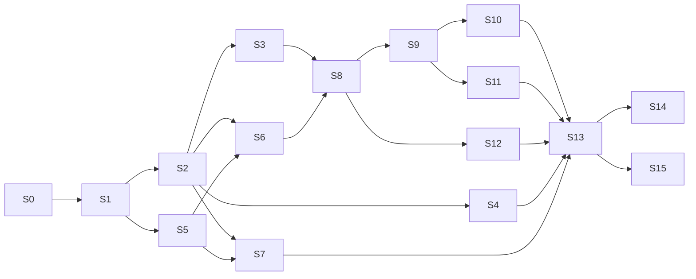

# DualMind Arena redesign: migration and architecture plan

Status: **approved** by Harsh on 2026-10-20, with the decisions recorded in section 9. Build started with slice S1.

Goal: move the Arena frontend from static HTML + vanilla JS to **React 19 + Vite + TypeScript + Tailwind CSS v4**, page by page, **without breaking any existing URL**, still served by the `dualmind-arena` Cloudflare Worker, still signing in with Supabase. The design rules are in [design-direction.md](./design-direction.md), the current screens and bugs in [screen-inventory.md](./screen-inventory.md), and new features in [new-features.md](./new-features.md).

---

## 1. Principles

1. **Strangler migration.** Old and new pages live side by side in one `dist/`. Each slice switches some routes to the new app; the rest keep serving the legacy files until their slice lands. Nothing is "big bang".
2. **Every URL that works today keeps working.** Either the new page renders at the same path, or the path answers with a `301` to its canonical path, keeping the query string (and the browser keeps the `#hash`). Supabase email targets render in place, with no redirect at all.
3. **The pre-launch gate stays.** `FORCE_WAITLIST`, the `?preview=dualmind-preview` cookie bypass and `run_worker_first: true` keep working throughout. Because production visitors are sent to the waitlist, slices can merge to `master` without exposing half-migrated states. Turning the gate off is a separate, deliberate step after the redesign.
4. **Heavy work runs in GitHub Actions.** Builds, tests, Playwright, screenshots and Lighthouse run in CI on every PR; results come back as artifacts.
5. **Small PRs.** One slice = one PR, reviewable in one sitting, with screenshots attached.

---

## 2. Target architecture

> The structure as built (feature-based `web/src`, conventions, build and deploy) is described in [docs/architecture.md](../architecture.md), with the decisions in [docs/adr/](../adr/README.md).

```text
DualMind_UI/
├── web/                         # NEW: the React app (pnpm workspace package)
│   ├── app/
│   │   ├── root.tsx             # html shell, fonts, theme script, providers
│   │   ├── routes.ts            # explicit route table (keeps today's URLs)
│   │   ├── routes/              # one module per screen (lazy, code-split)
│   │   ├── components/
│   │   │   ├── ui/              # shadcn/ui primitives (copied in, Base UI)
│   │   │   ├── reactbits/       # vendored React Bits (TS-TW) + LICENSE.md
│   │   │   ├── magicui/         # vendored Magic UI + LICENSE.md
│   │   │   ├── shell/           # Header, Footer, MobileNav, CommandPalette, ThemeToggle
│   │   │   ├── arena/           # Composer, AnswerPane, VoteBar, RevealCard, ThreadList...
│   │   │   └── marketing/       # Hero, LiveStrip, BattleReplay, Steps...
│   │   ├── lib/
│   │   │   ├── api/             # typed API client, schemas, errors, vote queue
│   │   │   ├── auth/            # supabase client, AuthProvider, session migration
│   │   │   ├── battle/          # useBattle state machine
│   │   │   ├── motion/          # useReducedMotion, WebGL gate, motion presets
│   │   │   └── markdown/        # hardened Streamdown config
│   │   ├── content/             # copy for info/legal pages, recorded demo battles
│   │   └── styles/              # tokens.css, base.css, prose.css
│   ├── public/                  # favicons, og images
│   ├── tests/                   # Playwright e2e, axe, screenshots
│   ├── react-router.config.ts   # ssr:false + prerender list
│   ├── vite.config.ts
│   └── package.json
├── worker.js                    # Arena Worker (kept at root; routing rules updated)
├── wrangler.jsonc               # assets dir stays dist/
├── build.js                     # composes dist/: legacy files + web build overlay
├── waitlist-worker/             # unchanged (separate app and Worker)
└── (legacy html/css/js)         # deleted slice by slice, gone after the cutover
```

### Stack decisions

| Concern | Choice | Why |
| --- | --- | --- |
| Build | Vite 7, TypeScript strict, pnpm workspace (root already uses pnpm 10 in CI) | Same toolchain as the waitlist app |
| Routing | **React Router v8, framework mode with `ssr: false` + `prerender`** | Explicit route table (exact legacy paths), per-route code splitting, per-route `meta` (title, canonical, OG), static HTML for public pages at build time, SPA fallback for app routes. No server runtime needed. Verified in a spike in S1; fallback is library mode + the waitlist's prerender script |
| Styling | Tailwind v4 (`@tailwindcss/vite`), CSS variables from `tokens.css` via `@theme inline` | One token source, dark + light |
| Primitives | shadcn/ui (Base UI flavour, copied in) | Accessible, owned code |
| Effects | React Bits (TS-TW), Magic UI, Motion (`LazyMotion`) | See design-direction.md section 9 |
| Server state | TanStack Query | Caching, retries for GETs, background refresh of leaderboard and threads |
| Client state | `useReducer` state machine for battles + a small Zustand store for arena UI (sidebar, mode, selected models) | Testable, no global event bus |
| API validation | Zod schemas that normalise the backend's mixed camelCase/snake_case and `{items}`/array shapes | One place for the leniency |
| Markdown | Streamdown + `@streamdown/code` (Shiki) + `@streamdown/math` (KaTeX), hardened | Replaces marked + DOMPurify + highlight.js from CDNs |
| Auth | `@supabase/supabase-js` v2 from npm, one client | Replaces four CDN copies in three versions |
| Fonts | Fontsource (Bricolage Grotesque Variable, Playfair Display italic, DM Mono, JetBrains Mono Variable) | Self-hosted, no Google Fonts request |
| Icons | lucide-react | Matches the docs sites |

### Configuration

- `config.js` (runtime global) is replaced by Vite env variables read in `web/app/lib/config.ts`: `VITE_API_BASE_URL`, `VITE_SUPABASE_URL`, `VITE_SUPABASE_ANON_KEY`, `VITE_SITE_URL`.
- Values come from **Workers Builds build variables** (production and previews) and **GitHub Actions repository variables** (CI) at build time. Locally, `web/.env.local` (git-ignored) with `web/.env.example` holding placeholders only. No key is copied into new files; the old `config.js` disappears at cutover.
- Only public values (Supabase URL and anon key) are ever exposed to the browser. Nothing service-role, ever.

---

## 3. Routing: keeping every URL

### Route table (new app)

| URL | Route module | Render | Notes |
| --- | --- | --- | --- |
| `/` | `home.tsx` | Prerendered landing; switches to the arena when a session exists | One URL for landing and arena (see 3.3) |
| `/leaderboard/` | `leaderboard.tsx` | Prerendered shell + client data | Public data, no login needed |
| `/models/` | `models.tsx` | Prerendered shell + client data | |
| `/about/`, `/how-it-works/`, `/faq/` | info routes | Prerendered | FAQ structured data |
| `/privacy/`, `/terms/`, `/cookies/` | legal routes | Prerendered | |
| `/login/` | `login.tsx` | Prerendered | Canonical login (URL exists today) |
| `/signup/` | `signup.tsx` | Prerendered | New clean path |
| `/forgot-password/` | `forgot-password.tsx` | Prerendered | New clean path |
| `/update-password.html` | `update-password.tsx` | SPA fallback, rendered in place | Supabase reset-email target: **no redirect** |
| `/auth-callback.html` | `auth-callback.tsx` | SPA fallback, rendered in place | Supabase confirm-email target: **no redirect** |
| `/share/:id` and `/share/` (`?id=`) | `share.tsx` | SPA fallback, `no-store` | Fixes KNOWN_ISSUES.md #3 |
| `/settings/` | `settings.tsx` | SPA fallback, auth required | New |
| `/design/` | `design.tsx` | Prerendered, `noindex` | Living style guide |
| anything else | `not-found.tsx` | `404.html`, status 404 | |

### Legacy URL handling (in `worker.js`)

| Old URL | Becomes | Status |
| --- | --- | --- |
| `/index.html` | `/` | 301 |
| `/login-modern.html` | `/login/` | 301 (query kept, so `?redirect=` still works) |
| `/login/index.html`, `/login/login/`, `/login/login/index.html`, `/login/login/redirect.html` | `/login/` | 301 |
| `/signup-modern.html` | `/signup/` | 301 |
| `/forgot-password.html` | `/forgot-password/` | 301 |
| `/about/about/`, `/how-it-works/how-it-works/`, `/careers/careers/` | parent page | 301 |
| `/careers/` and everything under it | `/about/` (page removed, decided 2026-10-20) | 301 |
| `/auth-verify.html`, `/verify.html` (developer diagnostics) | `/` | 301 |
| `/login`, `/about` and the other slash-less forms | slash form | 301 (Workers assets `auto-trailing-slash`) |
| `/sw.js`, `/ads.txt` | removed (decided 2026-10-20) | 404 |

The worker keeps the redirect map as data (`legacyRedirects` object) with a unit test per row. Until a route's slice lands, its old file is still served from `dist/`, so the map only gains rows as slices merge.

If Harsh prefers strictly identical paths (no clean aliases at all), the same route modules can be mounted at `/login-modern.html`, `/signup-modern.html` and `/forgot-password.html` instead; the rest of the plan does not change.

### 3.3 One URL for landing and arena

`/` is the arena today, and logged-out visitors are bounced to the login page. The new `/`:

- is **prerendered as the landing page** (good for SEO, fast first paint, works without JS);
- has a tiny inline script in `<head>` that checks for a Supabase session key in `localStorage` and sets `data-session="1"` on `<html>` before the first paint, so a signed-in visitor sees the arena skeleton instead of a flash of marketing;
- after hydration, `AuthProvider` confirms the session and renders the arena shell. The hero composer and the arena's empty-state composer are the same component in the same place, so the switch is seamless.

**During the migration** (before the arena slices land), signed-in visitors at `/` are sent to the legacy app, served from the same `dist/` as `/legacy/app.html` (a copy of today's `index.html`; its relative script paths still resolve). That lets the landing ship early without freezing the old arena. The legacy entry is removed at cutover.

### 3.4 Thread URLs (new)

The legacy app keeps the current thread in memory only. The new arena adds deep links without changing existing URLs: `/?thread=<id>`. A path form such as `/c/<id>` can come later if wanted.

---

## 4. Auth port (Supabase)

> **Status (2026-10-21): built in slice S6** ([PR #43](https://github.com/dualmindlabs/DualMind_UI/pull/43)). As planned, with these details: supabase-js is lazy-loaded; the store mirrors the session into `dualmind.auth.supabase` while the legacy arena exists (the legacy keys are removed on sign-out; removing them at load waits for S13); phone sign-in is a "Phone code" tab on `/login/` (sign-up by phone is not ported); the sign-up terms checkbox became a consent line. The build reads `VITE_SUPABASE_URL` / `VITE_SUPABASE_ANON_KEY` and, until those Workers Builds variables are set, falls back to the public values in the legacy `config.js` (replace before S13 deletes it). Production redirect targets are unchanged, so Supabase needs no change for production; see [needs-harsh.md](./needs-harsh.md) item 1 for the build variables and the optional preview allow-list entry.

- **One client** in `web/app/lib/auth/supabase.ts`: `createClient(url, anonKey, { auth: { persistSession: true, autoRefreshToken: true, detectSessionInUrl: true, flowType: 'implicit' } })`.
  - `flowType` stays `implicit` for now, because the email templates and links already in inboxes return tokens in the `#hash`, and PKCE email links only work in the browser that asked for them. Moving OAuth to PKCE is a later, separate change.
  - The storage key stays Supabase's default (`sb-<project-ref>-auth-token`), which today's client also writes, so legacy pages and new pages share the session during the migration.
- **Session migration:** on first load, if there is no default-key session but `localStorage['dualmind.auth.supabase']` holds one, call `setSession({ access_token, refresh_token })`, then remove `dualmind.auth.supabase`, `dualmind.auth.token`, `dualmind.auth` and `supabase.auth.token` once the legacy app is gone. Unit-tested with fixtures.
- **AuthProvider** exposes `session`, `user`, `profile` (from `POST /api/users/sync`), `signIn*`, `signOut`; route guards redirect to `/login/?redirect=<path>` with the same same-origin check `auth-modern.js` uses today (and a loop guard).
- **Methods kept:** email + password, email one-time code, phone one-time code, Google and GitHub OAuth, password reset, update password, profile update. The pwned-password range check on sign-up stays (k-anonymity API, no password leaves the browser).
- **Callbacks:**
  - `/auth-callback.html`: waits for `detectSessionInUrl`, reads `type` (`signup`, `email_confirmation`, `recovery`), sends recovery to `/update-password.html` with the hash, others to `?redirect` or `/`. Fixes today's broken import (screen-inventory.md 3.7).
  - OAuth returns to the bare origin `/`, which runs the same detection.
- **Supabase dashboard (Harsh, before S6 merges):** production redirect targets do not change (`/auth-callback.html`, `/update-password.html` and the bare origin stay). Add these to Authentication > URL Configuration > Redirect URLs and keep every existing entry; Site URL stays `https://arena.dualmindlab.tech`:
  - `https://arena.dualmindlab.tech/**` (covers the new clean paths and `?redirect=` returns)
  - `https://*-dualmind-arena.creharsh.workers.dev/**` (Workers Builds preview URLs, so sign-in can be tested on PR previews)
  - `http://localhost:5173/**` (local development)
- **Welcome email** edge function (`email-wel-safe`) keeps its contract (bearer token + `apikey`, 30 s debounce).
- **Tokens and XSS:** the session stays in `localStorage` (Supabase's model for SPAs). The mitigation is removing third-party scripts and enforcing a strict CSP (section 5).

---

## 5. API client and Worker

### Typed client (`web/app/lib/api/`)

- Same endpoints as today (see README "API endpoints used"). The full contract (types, errors, streaming format, known issues) is in [docs/api/endpoints.md](../api/endpoints.md). Function surface: `getHealth`, `listModels`, `getModel`, `startBattle`, `sendChat`, `streamChat`, `vote`, `getLeaderboard`, `listThreads`, `createThread`, `getThread`, `listThreadMessages`, `renameThread`, `deleteThread`, `setThreadVisibility`, `getSharedThread`, `syncUser`, `getMe`, `textToSpeech`.
- Zod schemas normalise responses (camelCase and snake_case, `{items}` or arrays) into one typed shape.
- `fetch` with `AbortController`, timeouts and typed errors (`AuthError`, `RateLimitError` with `Retry-After`, `ValidationError`, `NetworkError`, `ApiError`).
- **No automatic retries for `POST` battle and chat calls** (today they retry and can create duplicate battles). GETs retry through TanStack Query.
- **No mock answers shown as real ones.** Today the app silently falls back to canned replies when the API is down. The new app shows an honest offline state; demo battles are labelled as recordings.
- Votes go through a versioned offline queue (`dm.voteQueue.v1`), flushed on reconnect, cleared on sign-out.
- Text to speech calls the real route `POST /api/speech/generate` (fixes KNOWN_ISSUES.md #7).
- SSE parser for `/api/arena/chat/stream` (`data:` lines, `ai.stream.delta`, `ai.stream.done`, `ai.error`), shared by Direct mode and future streamed battles.

### Same-origin API through the Worker

The browser calls `api.dualmindlab.tech` cross-origin today. The new client calls **same-origin `/api/*`**, and the Worker proxies it. That keeps CORS out of the picture, hides the backend origin and allows a tight CSP (`connect-src 'self' https://<project>.supabase.co`). The proxy is hardened in the same slice:

- forward only `Authorization`, `Content-Type`, `Accept`, `Accept-Language` and a request id;
- no `Access-Control-Allow-Origin: *` (same-origin needs none);
- drop the `x-dualmind-proxy-*` headers and never return `error.toString()`;
- stream responses straight through (SSE), with a timeout for non-streaming calls;
- unit tests with a fake backend.

### Worker routing and headers (updated `worker.js`)

Order of handling:

1. Waitlist gate (unchanged behaviour, including `?preview=` handling).
2. `/api/*` hardened proxy.
3. `legacyRedirects` map (301).
4. `/share/*`, `/auth-callback.html`, `/update-password.html`, `/settings/` and other client-only routes: serve the SPA fallback HTML with status 200.
5. Static assets (`env.ASSETS`), `html_handling: auto-trailing-slash`, `not_found_handling: 404-page`.

Headers:

- `/assets/*` (Vite hashed files): `public, max-age=31536000, immutable`.
- HTML: `no-cache` (revalidate on every visit, cheap with ETags) instead of today's `no-store`. `/share/*`: `no-store`.
- Security headers on HTML:
  - `Content-Security-Policy`, shipped as `Report-Only` first, then enforced at cutover: `default-src 'self'; script-src 'self' 'sha256-<theme+session inline script>'; connect-src 'self' https://<project>.supabase.co; img-src 'self' data: blob:; style-src 'self' 'unsafe-inline'; font-src 'self'; frame-ancestors 'none'; base-uri 'self'; form-action 'self'`.
  - `X-Content-Type-Options: nosniff`, `Referrer-Policy: strict-origin-when-cross-origin`, `Permissions-Policy` (camera, geolocation off; microphone `self` for voice input later).
  - `Strict-Transport-Security`.
  - Drop the deprecated `X-XSS-Protection`.
- `robots.txt` and `sitemap.xml` are generated at build time from the route table (one source, real `lastmod`), no longer hardcoded in the Worker.

---

## 6. Build and deploy

### During the migration

- `pnpm build` at the root runs `pnpm --filter web build` (React Router build into `web/build/client`), then `node build.js`, which:
  1. copies the legacy allowlist into `dist/` as today (minus routes already migrated);
  2. copies `web/build/client` over it (new HTML at the same paths, hashed `/assets/*`, `404.html`; the SPA fallback is renamed so it never replaces the legacy `index.html`);
  3. writes `dist/legacy/app.html` from `index.html` while the legacy arena still exists;
  4. fails the build if a migrated route still has a legacy file, or if any sitemap URL is missing from `dist/`.
- `wrangler.jsonc` keeps `assets.directory = dist`, `run_worker_first: true`, and adds `html_handling` and `not_found_handling`. The uncommitted local `observability` edit (missing comma) is left to Harsh; it is not part of these PRs.

### Deploy path

- **Decided (2026-10-20): Cloudflare Workers Builds stays the deploy path**, unchanged. It deploys `dualmind-arena` from `master` and builds every PR branch as the `Workers Builds: dualmind-arena` check, which publishes a **preview alias URL** per branch (`https://<branch-slug>-dualmind-arena.creharsh.workers.dev`). Those previews are the clickable preview of each slice (add `?preview=dualmind-preview` once to pass the waitlist gate). No dashboard settings are changed.
- Because the dashboard build command is not changed, the root build is self-contained: `node build.js` installs and builds `web/` itself (skippable with `SKIP_WEB_BUILD=1` in CI), then composes `dist/`. A root `.node-version` pins Node 22 for Workers Builds.
- Node 22 in CI as well.

### Cutover (slice S13)

When every route is migrated: `build.js` overlay goes away (dist = `web/build/client`), legacy HTML/CSS/JS, `config.js`, CDN scripts, `components/`, `js/`, `css/` and dead root scripts are deleted, CSP switches from report-only to enforced, docs are updated. Turning `FORCE_WAITLIST` off is **not** part of the cutover; it is Harsh's call afterwards.

---

## 7. Test plan

Everything runs in GitHub Actions (`.github/workflows/web.yml`) on PRs that touch `web/**`, `worker.js`, `wrangler.jsonc` or `build.js`. Nothing heavy runs on the VM.

| Layer | Tool | What it covers | Gate |
| --- | --- | --- | --- |
| Static | `tsc --noEmit`, ESLint (flat config, `react-hooks`, `jsx-a11y`, no `dangerouslySetInnerHTML` outside the markdown module), Prettier check | Types, a11y lint, unsafe HTML | Required |
| Unit | Vitest + Testing Library + MSW | API normalisation (fixtures from real responses), `useBattle` transitions, vote queue, session migration, redirect sanitiser, Markdown hardening against an XSS payload corpus, SSE parser | Required |
| Worker | Vitest in Node with a fake `ASSETS` and fake backend (pattern from `waitlist-worker/tests/api.spec.ts`) | Waitlist gate and preview cookie, every legacy redirect row, SPA fallback routes, `/share/<id>`, headers and CSP, API proxy header filtering and streaming | Required |
| End to end | Playwright (Chromium; WebKit for the auth and arena flows) against the built `dist/` served by `wrangler dev` | Landing to demo battle; sign in (mocked Supabase) to battle, vote, reveal; leaderboard filters; share link; auth callback with hash; password reset; every URL in screen-inventory.md section 5 answers as expected | Required |
| Accessibility | `@axe-core/playwright` on every route, dark and light, plus keyboard-only flow tests | Zero serious or critical violations | Required |
| Visual | Playwright screenshots: every route at 1440x900 and 390x844, dark and light, plus reduced motion; uploaded as the `web-screenshots` artifact and linked in the job summary | Design review on every PR | Artifact |
| Visual regression | `toHaveScreenshot` baselines (animations off, live data mocked), committed once the design settles (after S7), updated by a `workflow_dispatch` job that commits to the PR branch | Unintended visual changes | Required from S8 |
| Performance | Lighthouse CI on prerendered pages (mobile); bundle budget check | Perf >= 90, a11y = 100, SEO = 100; initial JS on marketing pages <= 180 KB gzip, arena route <= 260 KB gzip | Required from S3 |

API calls in tests are always mocked (Playwright `page.route` / MSW). No test sends a `POST` to the production API.

---

## 8. Work packages (one PR each)

Size: S = under a day, M = 1-3 days, L = 3-5 days of focused work.

| # | Slice | Contents | Depends on | Size |
| --- | --- | --- | --- | --- |
| S0 | Plan (this PR) | These four documents | | S |
| S1 | Foundation | `web/` scaffold (Vite, React 19.2, TS strict, Tailwind v4, React Router v8 SPA + prerender spike), `tokens.css`, fonts, theme (system/dark/light, no flash), `/design/` style guide page, root build composition, Worker asset caching + SPA fallback, `web.yml` (typecheck, lint, unit, build, screenshots, axe) | S0 approved | M |
| S2 | UI kit and shell | shadcn/ui primitives (Base UI), Header, Footer, MobileNav, ThemeToggle, CommandPalette shell, Wordmark SVG, toasts, motion utilities (`useReducedMotion`, WebGL gate with poster fallback), vendored React Bits and Magic UI with license files, prose styles; all shown on `/design/` | S1 | M |
| S3 | **Landing** (`/` signed out) | Hero (Light Rays, Blur Text, composer), Animated Beam battle explainer with recorded battles, live strip, Logo Loop, how it works, top-5 preview, closing CTA, signed-in handoff to the legacy app, OG image, Lighthouse gate | S2 | L |
| S4 | Info, legal, 404 | `/about/`, `/how-it-works/`, `/faq/`, `/privacy/`, `/terms/`, `/cookies/`, `404`, policy text that still mentions ads or analytics rewritten, meta + OG + structured data, sitemap/robots from the route table, duplicate-URL redirects | S2 | M |
| S5 | API client and data layer | Typed client, Zod schemas, errors, TanStack Query setup, vote queue, SSE parser, hardened Worker `/api` proxy, unit + Worker tests | S1 | M |
| S6 | Auth | `/login/`, `/signup/`, `/forgot-password/`, `/update-password.html`, `/auth-callback.html`, AuthProvider, session migration, guards, `?redirect=`, legacy auth redirects, OTP and OAuth UI | S2, S5 | L |
| S7 | Leaderboard and models | Public `/leaderboard/` and `/models/` with podium, table, filters, search, detail sheet with charts, provisional flags | S2, S5 | M |
| S8 | Arena shell | Signed-in `/`: layout, sidebar threads (search, date groups, rename, delete), composer, mode switch, model picker (cmdk), settings menu, keyboard map, `/?thread=` deep links | S3, S5, S6 | L |
| S9 | Battle flow | `useBattle` machine, two panes with progressive reveal, vote bar, reveal moment, live-region announcements, mobile swipe layout, offline and error states, shortcuts | S8 | L |
| S10 | Side by side and Direct | Named pair mode, Direct mode with real SSE streaming, stop, copy, read aloud via the fixed TTS route | S9 | M |
| S11 | Share | Share dialog (visibility), `/share/<id>` read-only view with reveal applied, per-share meta, Worker route fix | S5, S9 | M |
| S12 | Settings and export | `/settings/` (profile, theme, default mode, shortcuts, reduced motion override), export md/json/csv/html/pdf | S8 | M |
| S13 | Cutover and cleanup | Remove legacy files, `config.js`, CDN deps, overlay build; enforce CSP; update README, AGENTS.md, CLAUDE.md | S3-S12 | M |
| S14 | Quality pass | Visual baselines, Lighthouse budgets on all public routes, manual screen-reader audit, bundle trimming, final screenshots for the portfolio | S13 | M |
| S15 | Shared tokens (optional) | Move tokens and fonts to `packages/tokens`, consume from `waitlist-worker` | S13 | S |

### Order and parallel lanes



- **Fast wow:** S1 gives a screenshot-able design system page within the first PR; S3 (landing) is the first big visual moment, right after S2.
- **Parallel lanes after S2:** landing (S3), info pages (S4), auth (S6, once S5 is in) and leaderboard (S7) can be built at the same time by separate agents in separate worktrees, with one integrator reviewing.
- The arena itself (S8-S11) is sequential because each step builds on the last.

---

## 9. Risks and decisions

### Decisions (Harsh, 2026-10-20)

| # | Question | Decision |
| --- | --- | --- |
| 1 | URL policy | **Clean canonical paths** `/login/`, `/signup/`, `/forgot-password/` with permanent redirects from the old `.html` URLs. `/auth-callback.html` and `/update-password.html` (Supabase email targets) stay at their current addresses |
| 2 | Ads and third-party scripts | **Removed:** `monetag` meta tag, `ads.txt`, `sw.js` (separate small PR, ahead of S1) |
| 3 | Careers page | **Removed;** `/careers/` and everything under it redirects to `/about/` |
| 4 | Deploys | **Keep Cloudflare Workers Builds.** No Actions-based deploy, no dashboard changes. Previews come from Workers Builds preview URLs |
| 5 | Supabase allow-list | Harsh adds the URLs listed in section 4 before the auth slice (S6) merges |

### Risks

| Risk | Mitigation |
| --- | --- |
| React Router v8 SPA + prerender behaves differently from expectations on Workers assets (trailing slashes, fallback file name) | S1 spike proves it in CI before anything else depends on it; fallback is library mode + the waitlist prerender script |
| Users signed out by the auth change | Default storage key shared with legacy, plus a tested one-time migration from `dualmind.auth.supabase` |
| Email links in inboxes break | `/auth-callback.html` and `/update-password.html` render in place; implicit flow kept |
| Mixed old/new look during the migration | Gate keeps production on the waitlist; slices grouped so public pages switch together (S3, S4, S7 close together) |
| Battles are not really streamed (`dualchat` returns both answers at once) | Readable progressive reveal now; true streaming is a backend follow-up (new-features.md B-1) |
| Heavy WebGL on phones | Hero only, gated, poster fallback, Lighthouse budget in CI |
| The unmerged `feature/energy-system` branch (credits, payments) diverges from this plan | Out of scope for a CV showcase; it is not ported. If Harsh wants credits shown, the profile's `energy_balance` can be displayed read-only |
| Backend contract drift (mixed key styles) | Zod normalisation + fixtures from real responses; contract tests in the backend phase |

---

## 10. How progress is reported

- Each slice PR includes: what changed, screenshots (desktop and mobile, dark and light), test results, and the updated checklist from design-direction.md section 14.
- After each merge: the "Arena web app" and "Brand and tokens" pages of the developer docs are updated (separate PR to the docs repo), and the Notion project page gets a progress entry.
- `docs/redesign/` stays the source of truth: this plan is updated when a decision changes, with the date.
